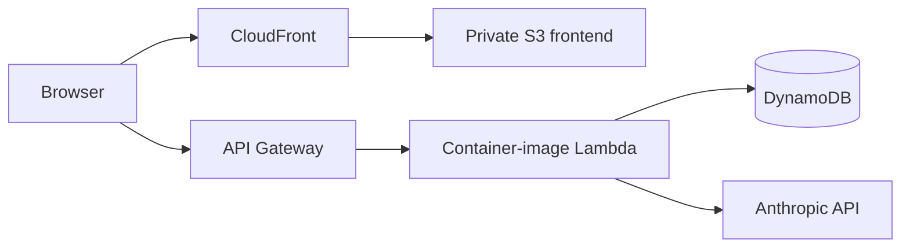

# PureZen

PureZen is a spa booking app with a guest booking flow and an admin console for schedules, guest history, and analytics. It started as an AWS Academy capstone.

## Deployment history

The capstone ran on EC2 with a load balancer in an AWS Academy VPC. After the capstone, the frontend moved to Vercel and the FastAPI backend ran on Hetzner with a local Ollama runtime. The repository now contains the serverless AWS setup, and some of the original Academy infrastructure survives only in the project history.

Commit [`5a29d28`](https://github.com/jetty-setter/purezen/commit/5a29d288ff1fbfb5694d244c93bc34118818c38a) added the Mangum adapter, converted the backend to an AWS Lambda container image, and removed the local Ollama dependency from the deployment path.

Commit [`5f759d2`](https://github.com/jetty-setter/purezen/commit/5f759d2c52cc748fd920672b30d4959ca5300f8a) introduced the TypeScript AWS CDK v2 stack for Lambda, API Gateway, DynamoDB permissions, and deployment configuration.

Commit [`db5fbb6`](https://github.com/jetty-setter/purezen/commit/db5fbb64053e81cba66202c7d48b5a5eabcd6cdb) moved the frontend to private S3 + CloudFront and removed the old backend origin from CORS.

Commit [`64b0d3b`](https://github.com/jetty-setter/purezen/commit/64b0d3b9f084fb5cdd5fdebd8f920c2c4c3d4349) removed obsolete Vercel/Hetzner deployment artifacts after the Lambda migration.

## Current architecture



Mangum lets the existing FastAPI app run on Lambda. CloudFront serves the static frontend from a private S3 bucket. The TypeScript CDK stack defines the deployment and retains the existing DynamoDB application tables.

- [CDK stack](cdk/lib/cdk-stack.ts)
- [FastAPI entry point](app/main.py) and [Lambda container build](Dockerfile)
- [Anthropic integration](app/llm.py)
- [Frontend API configuration](frontend/config.js)
- [DynamoDB table definitions](dynamodb-schema/)

## Portfolio demo data

The read-only public admin console uses demo appointments to populate the schedule, analytics, guest history, and operations assistant.

`scripts/seed_demo_bookings.py` creates a synthetic portfolio dataset directly in `purezen_availability` without changing real availability or real bookings. By default it creates 30 days of recent history plus future appointments through March 31, 2027 using the existing staff/time schedule as a template.

Preview first:

```bash
python scripts/seed_demo_bookings.py
```

If the preview looks right, write the dataset:

```bash
python scripts/seed_demo_bookings.py --apply
```

Remove only the synthetic portfolio rows:

```bash
python scripts/seed_demo_bookings.py --reset
```

Every generated appointment is tagged with `demo_seed=true`, uses fictional `example.com` guest data and reserved 555 phone numbers, and can be regenerated later. If a different window is needed, `--future-days` can override the March 31, 2027 end date.
