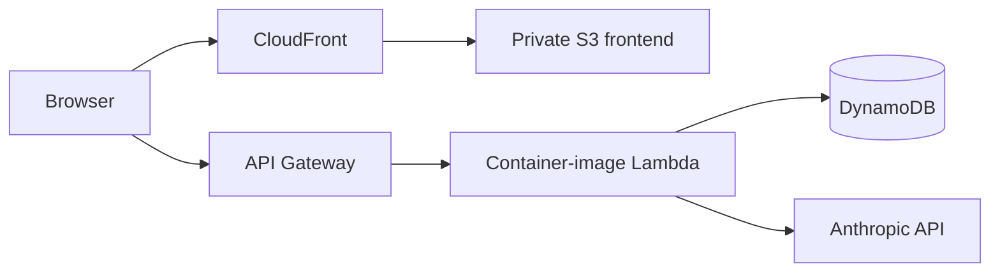

# PureZen

PureZen is a spa booking app with a guest booking flow and an admin console for schedules, guest history, and analytics. It started as an AWS Academy capstone.

## Book an appointment

On the [live spa homepage](https://purezen.stephsimmons.dev/#concierge), choose **Ask the concierge**. Try “Book a Swedish massage for tomorrow.” The concierge checks availability, offers times, and asks which one to reserve. Returning guests can use [My Account](frontend/account.html) to see their appointments.

- [Spa homepage source](frontend/index.html) and [concierge interface](frontend/script.js)
- [Conversation and booking flow](app/orchestrator.py)

## Deployment history

The capstone ran on EC2. After the course, the frontend moved to Vercel and the backend ran on Hetzner. The current AWS setup runs the same FastAPI app on Lambda through Mangum.

- [Move the API to Lambda](https://github.com/jetty-setter/purezen/commit/5a29d288ff1fbfb5694d244c93bc34118818c38a)
- [Define the AWS stack in CDK](https://github.com/jetty-setter/purezen/commit/5f759d2c52cc748fd920672b30d4959ca5300f8a)
- [Move the frontend to S3 and CloudFront](https://github.com/jetty-setter/purezen/commit/db5fbb64053e81cba66202c7d48b5a5eabcd6cdb)
- [Remove the old hosting configuration](https://github.com/jetty-setter/purezen/commit/64b0d3b9f084fb5cdd5fdebd8f920c2c4c3d4349)

## Current architecture



Mangum lets the existing FastAPI app run on Lambda. CloudFront serves the static frontend from a private S3 bucket. The TypeScript CDK stack defines the deployment and retains the existing DynamoDB application tables.

- [CDK stack](cdk/lib/cdk-stack.ts)
- [FastAPI entry point](app/main.py) and [Lambda container build](Dockerfile)
- [Anthropic integration](app/llm.py)
- [Frontend API configuration](frontend/config.js)
- [DynamoDB table definitions](dynamodb-schema/)

## Portfolio demo data

The read-only public admin console uses demo appointments to populate the schedule, analytics, guest history, and operations assistant.

`scripts/seed_demo_bookings.py` creates a synthetic portfolio dataset directly in `purezen_availability` without changing real availability or real bookings. By default it creates 30 days of recent history plus future appointments through March 31, 2027 using the existing staff/time schedule as a template.

Preview first:

```bash
python scripts/seed_demo_bookings.py
```

If the preview looks right, write the dataset:

```bash
python scripts/seed_demo_bookings.py --apply
```

Remove only the synthetic portfolio rows:

```bash
python scripts/seed_demo_bookings.py --reset
```

Every generated appointment is tagged with `demo_seed=true`, uses fictional `example.com` guest data and reserved 555 phone numbers, and can be regenerated later. If a different window is needed, `--future-days` can override the March 31, 2027 end date.
